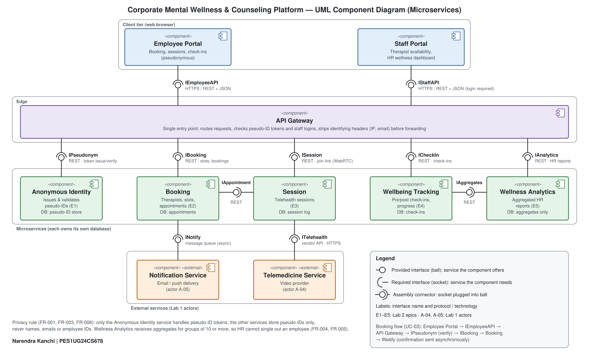

# Lab 3: Component Modelling & Architectural Pattern Selection

**Narendra Kanchi · PES1UG24CS678**

Scenario: **Corporate Mental Wellness & Counseling Platform**, using the
requirements from [Lab 1](../Lab1) and the epics from [Lab 2](../Lab2).

## Deliverables

| File | Description |
|------|-------------|
| `component_diagram.png` / `component_diagram.pdf` | UML component diagram |
| `component_diagram.svg` | Editable source of the diagram (opens in draw.io or a browser) |
| `architecture_justification.docx` / `.pdf` | One-page written justification |

## Step 1: Scenario review

**Key functional requirements (Lab 1 SRS):** anonymous pseudo-IDs that can
never be traced to an employee (FR-001, FR-006); a therapist directory by
speciality (FR-002); anonymous long-term tracking (FR-003); before/after
session check-ins and workforce-level results (FR-004); no coercion of
information (FR-005); booking, telehealth sessions, notifications and
wellness resources (UC-01 to UC-08).

**Key non-functional requirements:** a new anonymous ID generated within
milliseconds on every visit (NFR-001); correct time zones across global
offices (NFR-002); confidentiality throughout.

**Main challenges:**

- **Security / privacy:** identity and counseling data must never be
  linkable, and HR may only see aggregated results.
- **Availability:** an employee who needs help must be able to book even if
  notifications or the video provider fail (UC-03, alternate flow 8a).
- **Performance:** real-time video sessions and booking peaks after working
  hours.
- **Usability:** booking must be quick and simple for someone who may be
  under stress.

## Step 2: Architectural style analysis

| | Layered | Microservices | Client-Server |
|---|---|---|---|
| **Structure** | Presentation, business and data layers in one application | Small services, each with its own database, behind a gateway | One central server, many clients |
| **Privacy (FR-001/003/006)** | One shared database holds identities and counseling data | Pseudo-ID handling and counseling data kept in separate services and databases | One shared database on the server |
| **Failure of one part** | Whole application is affected | Contained to one service; booking still works if notifications fail | Server is a single point of failure |
| **Scaling** | Whole application scales together | Session and Booking scale on their own | Server becomes a bottleneck |
| **External providers** | Integration code spread across layers | Each wrapped by one service (ITelehealth, INotify) | All on the server |
| **Complexity** | Low | Higher: network calls, several databases | Low |
| **Fit** | Good for a simple prototype | **Best fit for the privacy and availability needs** | Too fragile for a support service |

**Selected: Microservices.** The full reasoning is in
`architecture_justification.pdf`.

## Step 3: Components

The handout's example components (Order Manager, Payment Service) belong to
the coffee-kiosk scenario. For this platform, the Booking service plays the
role of the order manager, and there is no payment: the employer funds the
programme.

| Component | Type | Responsibility | Lab 2 epic |
|-----------|------|----------------|------------|
| Employee Portal | Client | Pseudonymous booking, sessions, check-ins | — |
| Staff Portal | Client | Therapist availability, HR dashboard | — |
| API Gateway | Edge | Single entry point; routing, token and login checks, strips identifying headers | — |
| Anonymous Identity | Service | Issues and validates pseudo-IDs | E1 |
| Booking | Service | Therapist directory, slots, appointments | E2 |
| Session | Service | Telehealth sessions | E3 |
| Wellbeing Tracking | Service | Pre/post check-ins, personal progress | E4 |
| Wellness Analytics | Service | Aggregated HR reports (groups of 10 or more only) | E5 |
| Notification Service | External (A-05) | Email / push delivery | E3 |
| Telemedicine Service | External (A-04) | Video provider | E3 |

## Interfaces

| Interface | Provided by | Required by | Protocol |
|-----------|-------------|-------------|----------|
| IEmployeeAPI | API Gateway | Employee Portal | HTTPS / REST + JSON |
| IStaffAPI | API Gateway | Staff Portal | HTTPS / REST + JSON, login required |
| IPseudonym | Anonymous Identity | API Gateway | REST: issue / verify pseudo-ID tokens |
| IBooking | Booking | API Gateway | REST |
| ISession | Session | API Gateway | REST: returns a WebRTC join link |
| ICheckIn | Wellbeing Tracking | API Gateway | REST |
| IAnalytics | Wellness Analytics | API Gateway | REST |
| IAppointment | Booking | Session | REST: checks the session matches a booking |
| IAggregates | Wellbeing Tracking | Wellness Analytics | REST: aggregates for groups of 10 or more only |
| INotify | Notification Service | Booking | Message queue (asynchronous) |
| ITelehealth | Telemedicine Service | Session | Vendor API over HTTPS |
