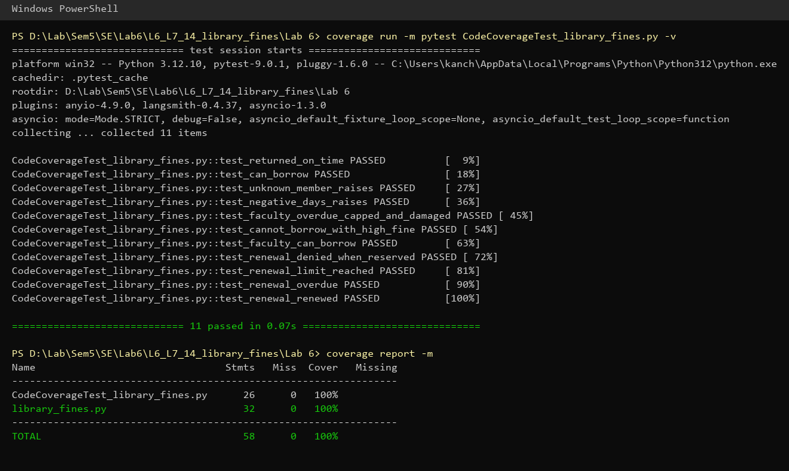
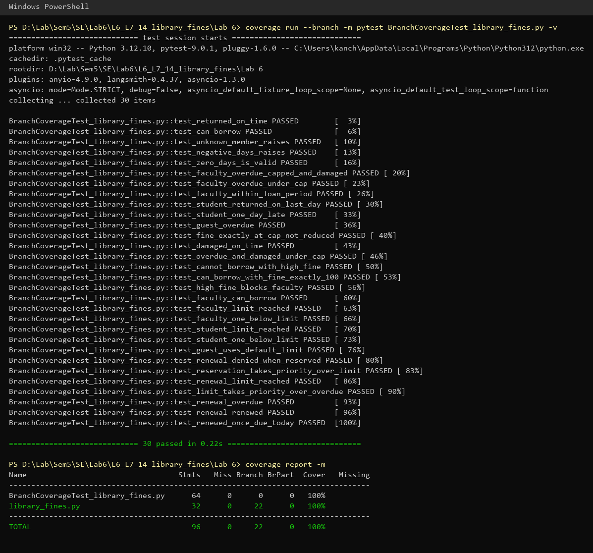

# L6_L7_14_library_fines — Library Fines

Lab 6: Code and Branch Coverage

## About

A small Python module that works out late return fines by member type, checks whether a member can borrow more books and decides if a book can be renewed.

## Files

| File | Description |
|------|-------------|
| `library_fines.py` | The module under test |
| `test_library_fines.py` | Starter test file |
| `CodeCoverageTest_library_fines.py` | Test cases for code (line) coverage |
| `BranchCoverageTest_library_fines.py` | Test cases for branch coverage |
| `screenshots/` | Terminal output of the coverage runs |

## How to run

```
pip install coverage pytest

coverage run -m pytest CodeCoverageTest_library_fines.py
coverage report -m

coverage run --branch -m pytest BranchCoverageTest_library_fines.py
coverage report -m
```

## Results

| Test file | Tests | Line coverage | Branch coverage |
|-----------|-------|---------------|-----------------|
| `test_library_fines.py` (starter) | 2 | 50% | 43% (7 partial branches) |
| `CodeCoverageTest_library_fines.py` | 11 | **100%** | 98% (missing `17->19`) |
| `BranchCoverageTest_library_fines.py` | 30 | **100%** | **100%** (22/22 branches) |

### Baseline (starter tests)

The two starter tests only exercise the "happy path" of `late_fine` and
`can_borrow`. Lines 6, 8, 10, 16-18, 20, 26, 28 and all of `renewal_status`
(33-39) never run.

### Code coverage

`CodeCoverageTest_library_fines.py` adds one test per unexecuted line:
an unknown member, negative days, an overdue + damaged faculty return that
hits the 200 cap, a blocked borrower with a high fine, a faculty borrower, and
one test for each of the four `renewal_status` outcomes. Every line now runs
(100% line coverage).



### Branch coverage

Running the code-coverage tests with `--branch` still reports `17->19` as a
missing branch: `if fine > 200` was only ever True, because the single overdue
test hit the cap. Line coverage could not detect this.

`BranchCoverageTest_library_fines.py` adds a faculty return that is overdue
but under the cap (`late_fine("faculty", 40, False) == 10`), which takes the
False side of that decision, plus boundary tests on both sides of every
condition:

- `late_fine`: 0 days, returned on day 14 / one day late, faculty within its
  30-day loan, guest rates, a fine of exactly 200 (not reduced), damage only,
  and damage + overdue under the cap.
- `can_borrow`: fine of exactly 100 (allowed) vs. 101 (blocked), the faculty
  limit at 9/10 books, the student limit at 2/3 books, and guests using the
  default limit.
- `renewal_status`: a reservation overriding the limit and overdue checks,
  the limit overriding overdue, and a book renewed once that is due today.

All 22 branches are taken (100% branch coverage).


